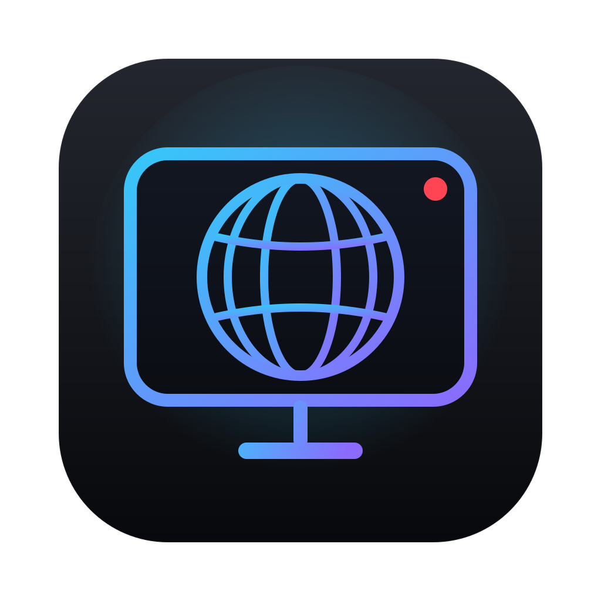

<p align="center">
  
</p>

<h1 align="center">World TV</h1>

<p align="center">
  A native macOS app for discovering and watching publicly available television channels from around the world.<br>
  SwiftUI · AVKit · macOS 13 Ventura+ · Universal (Apple Silicon + Intel)
</p>

---

## Contents

- [Overview](#overview)
- [Screenshots](#screenshots)
- [Features](#features)
- [System requirements](#system-requirements)
- [Architecture](#architecture)
- [Development setup](#development-setup)
- [Build instructions](#build-instructions)
- [GitHub Actions setup](#github-actions-setup)
- [Installing the DMG](#installing-the-dmg)
- [Code signing & notarization](#code-signing--notarization)
- [Keyboard shortcuts](#keyboard-shortcuts)
- [Troubleshooting](#troubleshooting)
- [Legal and streaming sources](#legal-and-streaming-sources)
- [Project status](#project-status)

## Overview

World TV brings together thousands of free-to-air channels — news, sports, entertainment, kids, music,
religious and general television — in one dark, Apple TV–style interface. Channels can be browsed by
country, continent, language and category, played with the native macOS player (full screen,
Picture-in-Picture), and organised into favorites and custom groups. You can also import your own
M3U/M3U8 playlists and XMLTV programme guides.

World TV hosts **no** content. The built-in directory is the public
[iptv-org](https://github.com/iptv-org/database) community database, downloaded at runtime, and every
stream belongs to its broadcaster.

## Screenshots

Screenshots will be added from the first CI build. (They are not included yet because this repository
was authored in an environment without macOS; see [Project status](#project-status).)

## Features

**Discovery**
- Public directory loaded from the iptv-org API at runtime and cached on disk — instant startup, works offline with the last copy, refreshes in the background (default every 24 h).
- Browse by country (Indonesia, Brunei, Malaysia, Singapore, United States, United Kingdom, Japan, South Korea, China, India, Australia, Germany, France and Saudi Arabia featured, plus every other country with channels), continent, language and category.
- Home: featured channels (a stable daily pick), recently watched, popular, recently added, categories.
- Closed, adult (NSFW) and DMCA-blocklisted channels are excluded; streams with unsupported schemes are dropped.

**Player**
- AVPlayer/AVPlayerView: HLS (M3U8) and MP4, play/pause, volume, mute, full screen, Picture-in-Picture.
- Live-TV behaviour: automatic fallback to the channel's next stream, reconnect with exponential backoff (configurable attempts), stall detection, return to live edge after pause.
- Loading, buffering, reconnecting and error states with clear messages (including a geo-block hint).
- Previous/next channel within the current list, aspect ratio (fit / fill / stretch), keyboard shortcuts.
- Shows channel logo, name, country, live resolution/bitrate, current programme and stream notes.

**Playlists & guide**
- Import M3U/M3U8 from a file or URL; parses `tvg-id`, `tvg-name`, `tvg-logo`, `tvg-country`, `tvg-language`, `group-title`, `#EXTGRP`, `#EXTVLCOPT` referrer/user-agent and Kodi-style `|User-Agent=` suffixes.
- Update, rename, remove playlists; per-stream health check that only reads the manifest/first kilobytes.
- XMLTV guides from the playlist header (`url-tvg` / `x-tvg-url`), a URL, or a file — plain or `.xml.gz`.
- TV Guide grid with now line, progress bars, programme details and a time-zone selector.

**Library**
- Favorites, watch history with durations, recently watched, recently added, custom channel groups.
- Everything is stored locally as JSON in the app's sandbox container.

**Search**
- Global search across channel name, alternative names, country name, language and category (diacritic-insensitive, all words must match), with filters and sorting (relevance, name, popularity, country, recently added).

## System requirements

| | |
|---|---|
| macOS | 13 Ventura or later |
| Hardware | Apple Silicon (M1–M4 and later) and Intel Macs — the app is built as a universal binary |
| Network | Internet connection for the directory and streams |
| Build | Xcode 16 or later (Swift 6 toolchain), [XcodeGen](https://github.com/yonaskolb/XcodeGen) |

## Architecture

MVVM with constructor-injected services; no third-party runtime dependencies.

```
WorldTV/
├── App/          App entry, menu commands, AppModel (composition root & navigation)
├── Models/       Channel, StreamSource, Country/Continent/Category, Playlist, Programme, UserLibrary, AppSettings
├── Views/        RootView, Components (theme, cards, rows), Screens (Home, Explore, Live TV, TV Guide, Favorites, Playlists, Settings, Search)
├── ViewModels/   CatalogViewModel, LiveTVViewModel, SearchViewModel
├── Services/     DirectoryAPI (iptv-org DTOs), CatalogBuilder, CatalogRepository, PlaylistService, SearchService, ImageCache
├── Networking/   HTTPClient protocol, URLSession client, retry policy, error mapping
├── Streaming/    PlayerController (AVPlayer state machine), M3UParser, XMLTVParser, StreamValidator
├── Database/     JSONFileStore (actor), LibraryStore
├── Resources/    Info.plist, entitlements, asset catalog (app icon)
└── Utilities/    Gzip (Compression framework), formatters, helpers
```

Data flow:

```
iptv-org API ──► DirectoryAPI ──► CatalogRepository (actor, disk cache) ──► CatalogBuilder ─┐
User playlists ─► PlaylistService ─► M3UParser ─────────────────────────────────────────────┼─► CatalogViewModel ─► Views
XMLTV guides ──► PlaylistService ─► XMLTVParser ─► ProgrammeGuide ─────────────────────────┘          │
                                                                                                         ▼
                                    LibraryStore (favorites, history, groups, settings) ◄── LiveTVViewModel ─► PlayerController ─► AVPlayer
```

Design decisions:
- **Metadata separate from the binary.** Channel records and stream URLs come from downloaded JSON (base URL in `DirectoryAPI.defaultBaseURL`), so the catalog updates without an app release. A failed or malformed download never replaces a good cache.
- **Persistence.** SwiftData requires macOS 14, so the app uses atomic Codable JSON files behind an actor; decoding is lenient, so new fields never wipe user data.
- **No main-thread blocking.** Downloads, parsing, joining, search and validation run on actors or detached tasks.
- **Popularity.** The directory has no viewing figures. "Popular" is a transparent heuristic (number and quality of streams, logo/website present, featured country) plus your own play counts.
- **Swift language mode.** The project builds with the Swift 6 compiler in Swift 5 language mode with `SWIFT_STRICT_CONCURRENCY = targeted`. Switching to strict Swift 6 mode (`SWIFT_VERSION: "6.0"`, `complete`) is a follow-up once the AVFoundation/KVO bridging is annotated.

## Development setup

```bash
brew install xcodegen
git clone https://github.com/<you>/WorldTV.git
cd WorldTV
xcodegen generate          # creates WorldTV.xcodeproj (not committed)
open WorldTV.xcodeproj     # run the "WorldTV" scheme
```

The Xcode project is generated from `project.yml`; edit that file rather than the project.

### Publishing this repository to GitHub

```bash
# create an empty repository named WorldTV on github.com first (no README/license), then:
git remote add origin https://github.com/<you>/WorldTV.git
git push -u origin main          # triggers unit tests + DMG build (artifact)
# when the main build is green:
git tag v1.0.0 && git push origin v1.0.0   # publishes the GitHub Release with the DMG
```

## Build instructions

```bash
Scripts/build.sh                 # Release archive → build/export/World TV.app (universal, ad-hoc signed)
RUN_TESTS=1 Scripts/build.sh     # run unit tests first
Scripts/create-dmg.sh            # → dist/WorldTV-1.0.0-macOS.dmg + .sha256
Scripts/validate.sh              # mount and verify the DMG
```

Run tests from the command line:

```bash
xcodegen generate
xcodebuild test -project WorldTV.xcodeproj -scheme WorldTVUnit -destination 'platform=macOS'
xcodebuild test -project WorldTV.xcodeproj -scheme WorldTV -only-testing:WorldTVUITests -destination 'platform=macOS'
```

Unit tests cover the M3U parser, XMLTV parser (incl. gzip and time zones), directory decoding and catalog
building, repository caching/offline behaviour, search and sorting, favorites/history/groups,
persistence, URL validation, stream health checks, HTTP retry policy, and the player's playback
lifecycle (fallback, reconnect, stale-callback handling).

## GitHub Actions setup

`.github/workflows/macos-release.yml` runs on every push and pull request to `main`, on `v*` tags, and manually:

| Job | Runner | What it does |
|---|---|---|
| Unit tests (x86_64) | `macos-15-intel` | Generate project, run `WorldTVUnit`, upload `.xcresult` and logs (required) |
| Unit tests (arm64) | `macos-15` | Same suite on Apple Silicon (non-blocking — arm64 hosted runners can be capacity-constrained) |
| UI tests | `macos-15` | XCUITest smoke tests (non-blocking — hosted runners may lack accessibility permissions) |
| Build DMG | `macos-15-intel` | Release archive (universal arm64 + x86_64), sign, create DMG, validate, SHA-256, release notes, upload artifacts and logs |
| Publish release | `ubuntu-latest` | On `v*` tags: GitHub Release with the DMG and checksum |

Release a version:

```bash
git tag v1.0.0
git push origin v1.0.0
# → Releases: WorldTV-1.0.0-macOS.dmg and WorldTV-1.0.0-macOS.dmg.sha256
```

Without signing secrets the workflow still produces an ad-hoc signed DMG.

## Installing the DMG

1. Open `WorldTV-<version>-macOS.dmg` and drag **World TV** onto **Applications**.
2. If the build is not notarized, macOS blocks the first launch. Either:
   - Control-click **World TV** in Applications → **Open** → **Open**; or
   - System Settings → Privacy & Security → **Open Anyway**; or
   - `xattr -dr com.apple.quarantine "/Applications/World TV.app"`

Verify the download: `shasum -a 256 -c WorldTV-<version>-macOS.dmg.sha256`.

## Code signing & notarization

Two configurations are supported:

**A. Development / unsigned (default).** Ad-hoc signature (`codesign -s -`), hardened runtime, DMG
packaged and validated. Users follow the Gatekeeper steps above.

**B. Production / Developer ID.** Add these repository secrets (Settings → Secrets and variables → Actions):

| Secret | Value |
|---|---|
| `APPLE_CERTIFICATE_BASE64` | Your *Developer ID Application* certificate + private key exported as `.p12`, base64-encoded: `base64 -i cert.p12 \| pbcopy` |
| `APPLE_CERTIFICATE_PASSWORD` | Password used when exporting the `.p12` |
| `KEYCHAIN_PASSWORD` | Any random string for the temporary CI keychain |
| `APPLE_ID` | Apple ID email used for notarization |
| `APPLE_TEAM_ID` | 10-character Team ID |
| `APPLE_APP_SPECIFIC_PASSWORD` | App-specific password from appleid.apple.com |

With the first three, the app and DMG are Developer ID signed with hardened runtime and a secure
timestamp. With all six, the DMG is also notarized (`notarytool --wait`) and stapled. Certificates and
passwords are only ever read from secrets and the temporary keychain is deleted at the end of the job.

To sign locally: `SIGN_IDENTITY="Developer ID Application: Name (TEAMID)" Scripts/build.sh && SIGN_IDENTITY=… Scripts/create-dmg.sh`.

## Keyboard shortcuts

| Action | Shortcut |
|---|---|
| Play / pause | ⌘P (Space when the video has focus) |
| Next / previous channel | ⌘→ / ⌘← |
| Volume up / down | ⌘↑ / ⌘↓ |
| Mute | ⌥⌘M |
| Reconnect stream | ⌘R |
| Stop | ⌘. |
| Toggle favorite | ⌘D |
| Full screen | ⌃⌘F |
| Switch screen | ⌘1 … ⌘7 |
| Refresh directory | ⇧⌘R |

## Troubleshooting

| Symptom | What to do |
|---|---|
| "World TV can't be opened because Apple cannot check it" | Unsigned build — see [Installing the DMG](#installing-the-dmg). |
| A channel shows "isn't available right now" | Public streams change often or are geo-blocked. Try again, try the next channel, or enable *Hide channels marked geo-blocked* in Settings. Broken streams can be reported to iptv-org. |
| The directory doesn't load | Check your connection and press **Refresh Now** in Settings → Network. The last downloaded copy keeps working offline. |
| Playlist import says "no playable channels" | The file must be an M3U with HTTP(S) stream URLs; RTMP/RTSP aren't supported by AVPlayer. |
| No programme guide | Add an XMLTV source in Playlists; channels match by `tvg-id` or display name. |
| CI: `macos-15-intel` unavailable | GitHub supports Intel runners until macOS 15 images retire (announced for fall 2027). Remove the matrix entry if needed. |
| CI: UI tests fail | Hosted runners can lack accessibility permissions; the job is non-blocking. Run UI tests locally. |

App data lives in `~/Library/Containers/io.github.worldtv.WorldTV/Data/Library/Application Support/WorldTV/`.

## Legal and streaming sources

- World TV is a player and directory browser. It does not host, record, rebroadcast or modify any content.
- The built-in directory is the [iptv-org database](https://github.com/iptv-org/database) via its
  [public API](https://github.com/iptv-org/api). iptv-org lists links to publicly available streams and
  removes entries on request; World TV additionally excludes adult content, closed channels and the
  iptv-org blocklist. Each channel shows its source attribution and usage notes in the app.
- Streams remain the property of their broadcasters and may be geo-restricted or change without notice.
- World TV contains no DRM circumvention and does not support paid-TV or private feeds. Only import
  playlists you own or are authorized to use.
- Source code: MIT License (see [LICENSE](LICENSE)).

## Project status

This repository was written without access to a Mac, so **it has not yet been compiled, run or packaged**.
The first real build happens in GitHub Actions on push. Expect to fix a small number of compiler errors
on the first run; the workflow uploads full build logs to make that quick. Screenshots and a verified
`WorldTV-1.0.0-macOS.dmg` will follow from that first green build.
